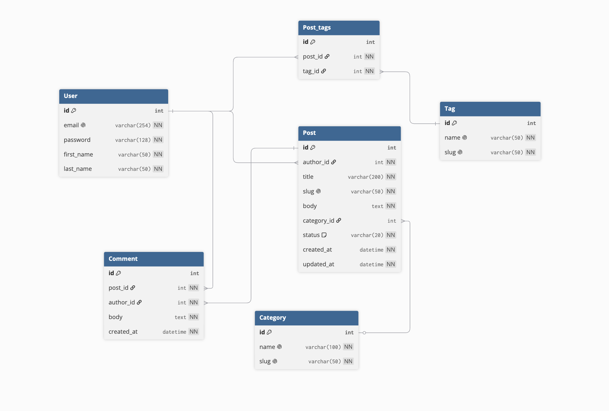
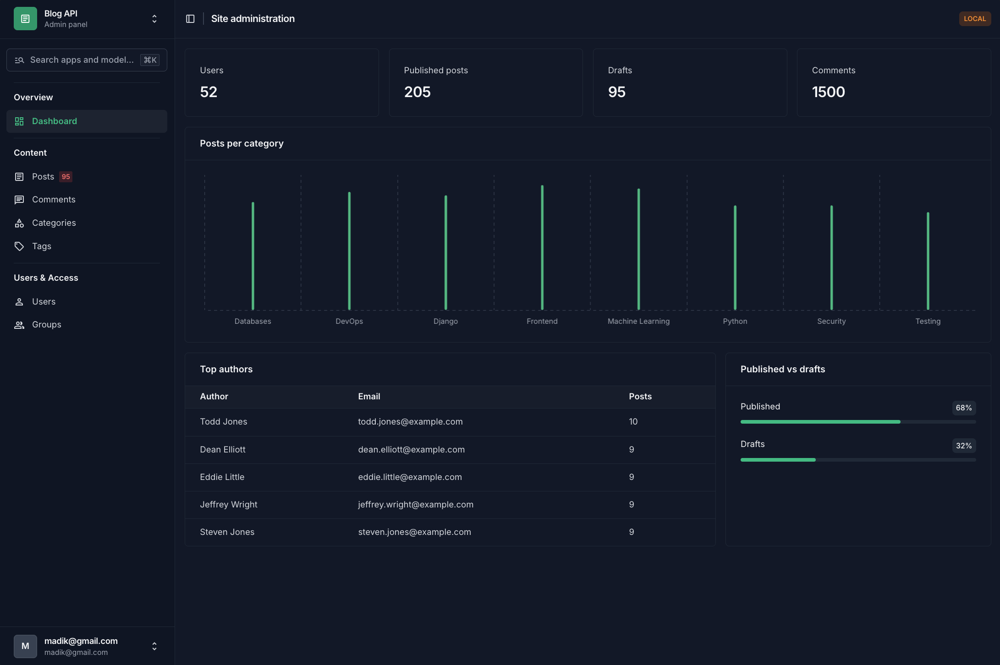
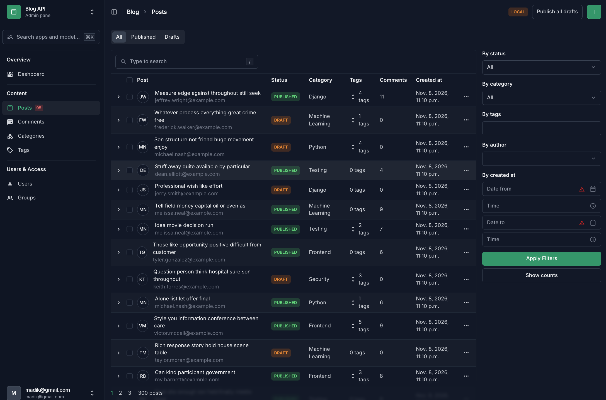
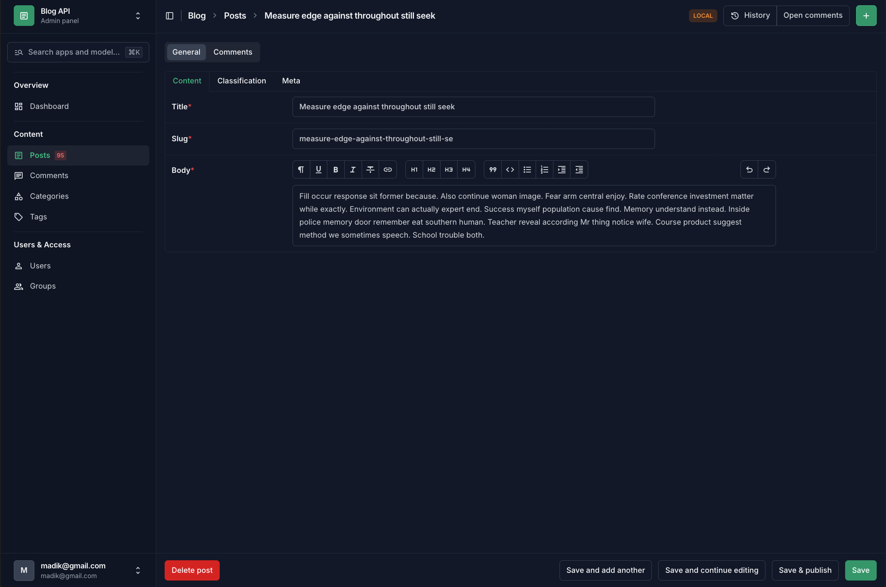
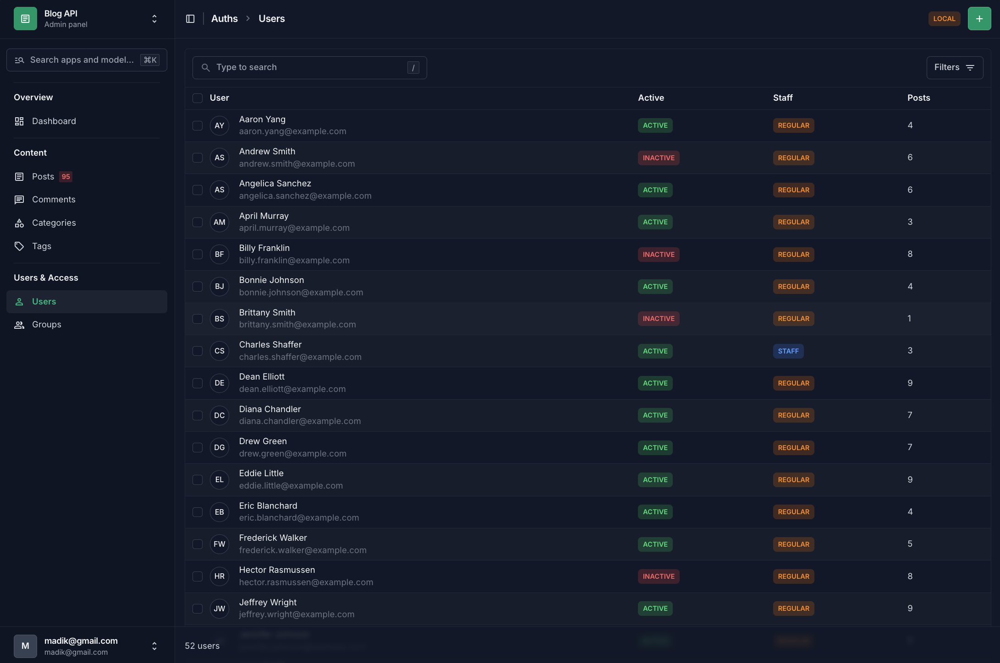

# blog-api
Django projects



## Quick start

```bash
python manage.py migrate
python manage.py seed
python manage.py createsuperuser
python manage.py runserver
```

Then open http://127.0.0.1:8000/admin/ and log in.

## Seeding

The `seed` command fills the database with fake data (users, categories, tags, posts and comments).

```bash
python manage.py seed
python manage.py seed --users 50 --posts 300 --comments 1500
python manage.py seed --clear
```

| Argument | Description |
|---|---|
| `--users N` | Number of users to create |
| `--posts N` | Number of posts to create |
| `--comments N` | Number of comments to create |
| `--clear` | Delete existing data before seeding (superusers are kept) |

Notes:
- All arguments are optional and have default values.
- Negative numbers are rejected with an error.
- Seeded users have emails like `name.surname@example.com` and the password `seedpass123`.
- At the end the command prints a summary of what was created and how long it took.

## Admin

The admin panel uses [Django Unfold](https://github.com/unfoldadmin/django-unfold).
It has a sidebar, a status tab filter for posts and a "LOCAL" / "PROD" environment label.

### Dashboard
Cards with totals, a chart of posts per category, the top 5 authors and the published/drafts ratio.



### Posts
Tabs (All / Published / Drafts), filters by status, category, tags, author and date,
search, bulk actions (publish, move to drafts) and a rich text editor for the body.
Comments are shown on the post page.





### Users
Active and staff status labels, number of posts per user, filters, search
and actions to activate or deactivate users.

